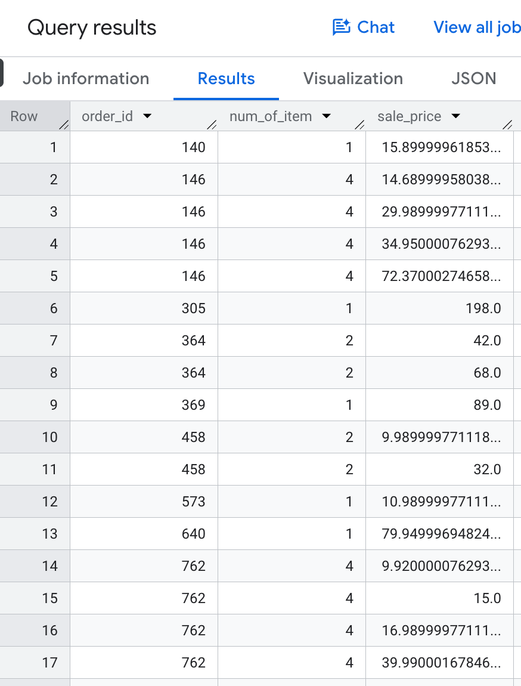

## Session 0 Challenge Answers

The problem with the query is that each order gets multiplied by the number of order items before the sum function is applied. So, if an order has 3 items, its 3 gets summed 3 times, resulting in a contribution of 9 to the total.

Run this query to see:

```sql
Select o.order_id, num_of_item, sale_price
from `bigquery-public-data.thelook_ecommerce.orders` o
join `bigquery-public-data.thelook_ecommerce.order_items` i
on o.order_id = i.order_id
where o.status in ('Complete')
and o.created_at >= '2026-09-01'
and o.created_at < '2026-10-01'
order by o.order_id;
```

**Results**



### Fix 1: Aggregate Different Column

Aggregate a different value from the many side of the join that is equivalent. There will not always be an equivalent value, so this strategy will not always work. In this case, we can count the order item id column instead.

```sql
Select count(distinct i.id) as items_shipped, sum(sale_price) as total_sales
from `bigquery-public-data.thelook_ecommerce.orders` o
join `bigquery-public-data.thelook_ecommerce.order_items` i
on o.order_id = i.order_id
where o.status in ('Complete')
and o.created_at >= '2026-09-01'
and o.created_at < '2026-10-01'
;
```

### Fix 2: Aggregate Twice

This is more complicated but will always work. We aggregate grouping by order, then aggregate again.

```sql
select sum(num_of_item) as items_shipped, sum(sales_per_order) as total_sales
from
(Select o.order_id, max(num_of_item) as num_of_item, sum(sale_price) as sales_per_order
from `bigquery-public-data.thelook_ecommerce.orders` o
join `bigquery-public-data.thelook_ecommerce.order_items` i
on o.order_id = i.order_id
where o.status in ('Complete')
and o.created_at >= '2026-09-01'
and o.created_at < '2026-10-01'
group by 1
)
;
```

Note: You have to aggregate all columns that are not grouped by. Max() is often used on columns where every value will be the same. The 1 in the group by statement is shorthand for the first argument in the SELECT. This syntax is supported by most warehouses and databases, but not SQL Server.
