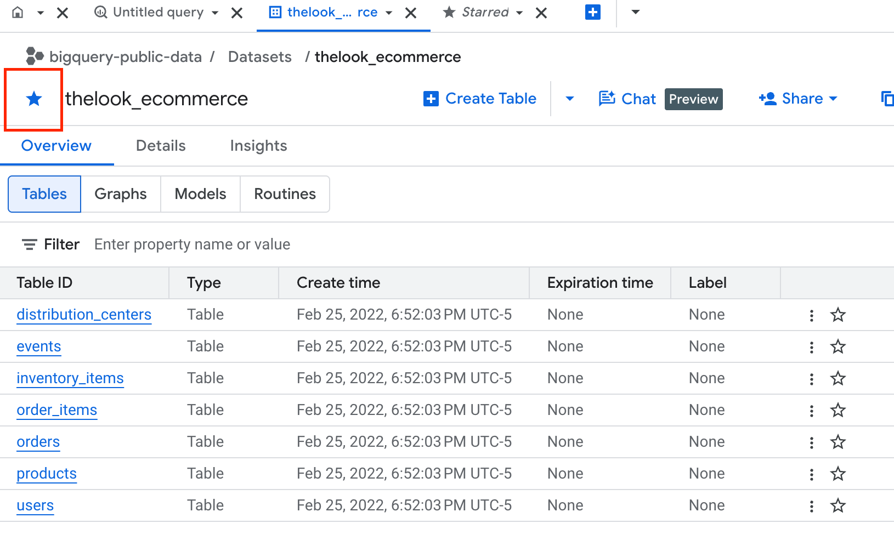

# SQL Training Session 0

Welcome to SQL training, I'm Catherine Theuer. My background is in software engineering and product management. My goal is to teach you how to use SQL to answer business questions. I want to make this training useful to both business and technical users. With that in mind, we are going to start with how to fetch data from warehouses.

I expect this series to be a learning experience for all of us. I'm happy to have your feedback on whether you feel this class is either too difficult or too easy. Also if you'd prefer that I go in a more technical direction (coding with databases) or data science direction (pandas/polars), I can do that too.

## Today's Goal

Everyone can access BigQuery and do some exploration there.

## SQL Basics

### Database vs Data Warehouse

A **database** runs the day-to-day work of an application. A **data warehouse** is built for analyzing data across the whole business, usually over long periods of time.

**Database (OLTP: online transaction processing)**

- **Purpose:** It records and updates current data as things happen, like placing an order, updating a customer's address, or booking a seat.
- **Workload:** Many small, fast reads and writes, often thousands per second.
- **Design:** Normalized, meaning data is split across many related tables to avoid duplication and keep it consistent.
- **Data:** Mostly the current state, often from a single application.
- **Examples:** PostgreSQL, MySQL, SQL Server, MongoDB.

**Data warehouse (OLAP: online analytical processing)**

- **Purpose:** Reporting, dashboards and analysis, like "What were sales by region per quarter for the last five years?"
- **Workload:** Fewer but much heavier queries that scan millions or billions of rows. Writes come in batches, not one at a time.
- **Design:** Often denormalized into star or snowflake schemas (fact tables plus dimension tables). Data is usually stored by column, which makes adding up large datasets fast.
- **Data:** Historical, and combined from many sources (databases, CRM, marketing tools, logs). It's cleaned and standardized on the way in through ETL/ELT pipelines.
- **Examples:** Snowflake, BigQuery, Amazon Redshift, Databricks SQL.

**An analogy:** A database is a store's cash register, recording each sale as it happens. A data warehouse is the accounting office that collects records from every register and store to spot trends.

**How they work together:** Apps write to databases. Pipelines copy that data, often nightly or in near real time, into the warehouse, where analysts and BI tools query it. That way, heavy analysis never slows down the live app.

A related term you may see is **data lake**, which stores raw data of any format cheaply. A **lakehouse** blends a lake with warehouse-style querying.

### SELECT Statement

A SELECT statement is built from clauses that each do one job. Here's a complete example, then each part explained:

```sql
SELECT      region, COUNT(*) AS num_orders, SUM(amount) AS total_sales
FROM        orders
JOIN        customers ON orders.customer_id = customers.id
WHERE       order_date >= '2026-01-01'
GROUP BY    region
HAVING      SUM(amount) > 10000
ORDER BY    total_sales DESC
LIMIT       5;
```

**The clauses, in the order you write them**

- **SELECT** picks which columns or calculated values appear in the result. `AS` gives a column a new name (an alias). `SELECT *` returns every column. `SELECT DISTINCT` removes duplicate rows.
- **FROM** names the table the data comes from.
- **JOIN ... ON** combines rows from another table using a matching condition. Types:
    - `INNER JOIN` keeps only rows that match in both tables.
    - `LEFT JOIN` keeps every row from the left table, with blanks (NULLs) where nothing matches.
    - `RIGHT JOIN` and `FULL OUTER JOIN` work the same way for the right table or for both.
- **WHERE** filters individual rows before any grouping. It uses conditions like `=`, `>`, `IN`, `LIKE`, `BETWEEN` and `IS NULL`, combined with `AND` and `OR`.
- **GROUP BY** puts rows that share the same values into groups, so aggregate functions (`COUNT`, `SUM`, `AVG`, `MIN`, `MAX`) can produce one result per group.
- **HAVING** filters the groups after they're formed. It's like WHERE, but for aggregated results.
- **ORDER BY** sorts the output. `ASC` (the default) sorts ascending and `DESC` sorts descending.
- **LIMIT** caps how many rows come back. SQL Server uses `TOP`, and some databases use `FETCH FIRST n ROWS`. `OFFSET` skips rows, which is useful for paging.

**The order the database actually runs them**

The order you write the clauses isn't the order they're processed:

1. FROM / JOIN: gather the data
2. WHERE: filter rows
3. GROUP BY: form groups
4. HAVING: filter groups
5. SELECT: compute the output columns
6. DISTINCT: remove duplicates
7. ORDER BY: sort
8. LIMIT / OFFSET: trim

This order explains two common surprises:

- You usually **can't use a SELECT alias in WHERE**, because WHERE runs before SELECT. You *can* use it in ORDER BY, which runs after.
- **WHERE can't contain aggregates** like `SUM(amount) > 10000`, because groups don't exist yet at that step. That's why HAVING exists.

Only SELECT is required. Some databases even allow `SELECT 1;` with no FROM. Every other clause is optional, but the ones you use must appear in the order shown above.

### Limiting Data Retrieved

Tables like transactions and events can contain millions (or billions) of rows. It is important to cut down the size of your result set through WHERE and LIMIT clauses. Otherwise, your query can run for hours and cost $$$.

The 3rd rail of SQL is '**full table scan**.' This gets triggered when the query parser can't use an index to find the right rows and scans the entire table.

**Indices**

Databases will index columns. Data warehouses tend to use a different strategy but it can be useful to pretend that they have indexes anyway. You should generally try to use columns in your WHERE clause that are indexed. Indexed columns are usually:

- IDs
- Dates

**Strategy**

1. Start with a count and a limit query.

    ```sql
    SELECT COUNT(*) FROM NEW_TABLE;
    ```

    ~~`SELECT * FROM NEW_TABLE LIMIT 10;`~~ This will still trigger full table scan on a warehouse

2. Use date.

    ```sql
    Select * from NEW_TABLE o
    where o.created_at >= '2026-09-01'
    ```

**Caution - Aggregate Functions**

Using a function on an argument in a where clause will cause it to not be able to use the index.

```sql
WHERE MONTH(o.created_at) >= 9
```

runs less efficiently than

```sql
where o.created_at >= '2026-09-01'
```

### More Info

- [https://sqlzoo.net/wiki/SQL_Tutorial](https://sqlzoo.net/wiki/SQL_Tutorial)
- [https://datalemur.com/](https://datalemur.com/)

## Today's Exercise

### Connect to BigQuery Sandbox

Follow Google's instructions: [https://docs.cloud.google.com/bigquery/docs/sandbox](https://docs.cloud.google.com/bigquery/docs/sandbox)

### Query eCommerce Data

1. Follow the same instructions to access 'theLook eCommerce' public dataset.

    TheLook is a fictitious eCommerce clothing site developed by the Looker team. The dataset contains information about customers, products, orders, logistics, web events and digital marketing campaigns. The contents of this dataset are synthetic, and are provided to industry practitioners for the purpose of product discovery, testing, and evaluation.

2. Star the dataset

    

3. Explore the orders and order_items table.

### Challenge

I wanted to figure out how many items we sold and how much revenue we generated in September. I wrote a query on just orders that found how many items we shipped:

```sql
Select sum(num_of_item) as items_shipped
from `bigquery-public-data.thelook_ecommerce.orders` o
where o.status in ('Complete')
and o.created_at >= '2026-09-01'
and o.created_at < '2026-10-01'
;
```

I got 2455 for items shipped. When I added a join to the order_items table to calculate total revenue, the items shipped jumped to 4643.

```sql
Select sum(num_of_item) as items_shipped, sum(sale_price) as total_sales
from `bigquery-public-data.thelook_ecommerce.orders` o
join `bigquery-public-data.thelook_ecommerce.order_items` i
on o.order_id = i.order_id
where o.status in ('Complete')
and o.created_at >= '2026-09-01'
and o.created_at < '2026-10-01'
;
```

What went wrong and how would you fix it to get both correct numbers out of 1 query? Hint: It is not order status or orders that crossed the month boundary. There are 2 potential ways to fix this.
